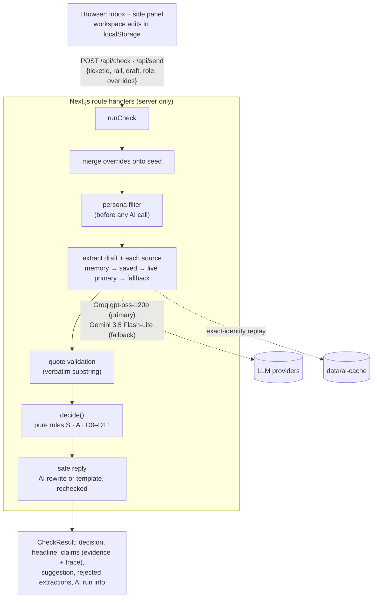

# SureSend

> SureSend was called AnswerGuard in SPEC v2.2 and the brief.

**An independent product concept for Slite Agent. Not affiliated with Slite. Synthetic data only.**

> Slite's drift detection keeps the docs current. SureSend checks the reply before it reaches the customer.

A support agent writes a reply. Before it's sent, SureSend:

1. pulls the factual claims out of the draft (live AI),
2. finds the matching claims in the team's messy docs and Slack (live AI, every quote validated as verbatim),
3. weighs those sources with transparent, deterministic rules, and
4. returns **Allow, Caution, Hold or Escalate**, plus a rechecked safe reply and the full reasoning.

**Live demo:** https://suresend-demo.vercel.app (the old https://answerguard.vercel.app redirects here) · **Source:** https://github.com/1AbdullahButt/suresend · works with no setup; the canonical path and the guided tour replay saved AI responses, so they work even when live AI is
unavailable or rate-limited.


## Use it from Claude

SureSend is also an MCP server, so any agent can check a reply against the docs before it sends it: Claude, a help-desk
bot, or an agent like Slite's.

**Connector URL:** `https://suresend-demo.vercel.app/api/mcp` (Streamable HTTP, stateless). **No auth:** it only reads the
public, synthetic demo workspace, so don't send real customer data to it.

- **claude.ai:** add it as a custom connector (in Settings → Connectors at the time of writing; menus move). Step-by-step,
  with a demo prompt: [docs/MCP_DEMO.md](docs/MCP_DEMO.md).
- **Claude Code:** `claude mcp add --transport http suresend https://suresend-demo.vercel.app/api/mcp`
- **Locally over stdio** (Claude Code or Claude Desktop, from a clone):
  `claude mcp add suresend-local -- pnpm --dir /path/to/suresend exec tsx scripts/mcp-stdio.ts`

| Tool | What it does |
|---|---|
| `check_reply` | `{ reply, ticket_id?, rail? }` → the decision (Good to send, Double-check, Hold, Ask first, or Couldn't check when the reply can't be read), headline, a one-line reason, the next step, a checked suggested reply, the governing quote and its doc, and the rules that mattered. It runs the same validation, caps, persona filter and engine as the web app, and covers the same one topic: when a failed transfer's money comes back. Other values come back Double-check. |
| `list_tickets` | The 3 demo tickets: customer, payment rail, the customer's message. |
| `get_doc` | One doc the support agent can see: title, verification signals and text. The restricted DOC-105 is never returned. |

The tool descriptions tell the agent to call `check_reply` before sending any reply that states a timeline, and to send
the suggested reply or ask a human on Hold or Ask first. Everything is read-only: nothing over MCP edits a doc. Live AI
over MCP has its own budget on the shared limiter (`MCP_RATE_LIMIT_PER_10MIN`, `MCP_LIVE_CHECKS_PER_DAY`; defaults 10
and 200), asked once per check; the endpoint takes one JSON-RPC message per request (no batches) and answers GET with
405, since it's stateless. The demo's canonical replies replay saved responses; new wording uses live AI.

Try these prompts:

1. "Reply to Ayesha's failed instant transfer. Check it with SureSend before you send."
2. "Usman doesn't know which payment rail his transfer used. Draft a reply about when his money comes back, and check it
   with SureSend first."
3. "Is 'Your refund will arrive within 4 business days' right for Hina's standard transfer? Show me the doc SureSend relied on."

## The problem

Slite detects drift in docs and routes the fixes through Triage. But between a policy change and the doc fix, an agent
can still type the old answer into a customer conversation. The doc that's verified isn't always the one that governs: a newer, more specific
exception can override it, an informal Slack proposal can look authoritative, and an outdated macro can still be the
first thing an agent copies.

## The hypothesis

Slite already has cited, permission-aware answers; drift detection with fixes reviewed in Triage; Ask Insights; a Slack
bot; MCP; and a Chrome extension. This concept tests something narrower, and it is presented as a hypothesis (Slite may
have something similar internally):

- check the **agent's own draft reply** at the moment of sending, not just answer a question;
- weigh conflicting sources with **explicit, inspectable rules**, where verification is one signal among several;
- measure **customer exposure**: unsafe sends intercepted, and the false-alarm rate.

## AI vs rules

| The AI does | The rules do |
|---|---|
| Pull claims out of the draft and each source: topic, value, unit, scope, effective date, status wording, supersession sentence, **verbatim quote** | Validate every quote, assign each claim a standing, check scope, settle conflicts, compare values, pick the decision |
| Word the safe reply from given facts | Recheck the safe reply; fall back to a template if it fails |

**The AI never decides the outcome.** The decision is a pure function, `decide(extractions, sources, ticket, now)` in
[`lib/engine/decide.ts`](lib/engine/decide.ts). Every rule writes a trace entry, shown in the Slite Agent card's Why and Trace views.
"The AI found nothing" is never treated as "safe": a deterministic policy-pattern detector catches timelines the AI missed,
and an unreadable source caps the result at Caution.

Key rules (full table in [SPEC.md §6](SPEC.md)):

- **Verification is not authority.** It only adds or removes weakeners; it never breaks a tie.
- **Explicit supersession beats inferred specificity** (D5 before D6), and every D5 condition is written to the trace.
- **Recency never breaks a tie.** Two general policies that disagree escalate.
- **Proposals never govern.** A Slack proposal or a future-effective change can only downgrade an Allow to Caution.

## Architecture



- **AI providers:** two live providers behind one adapter ([`lib/ai/client.ts`](lib/ai/client.ts)): Groq
  (`openai/gpt-oss-120b`, strict JSON-schema output) and Google Gemini (`gemini-3.5-flash-lite`, native JSON-schema
  response). The eval picked Groq as primary and Gemini as the fallback, which is tried once on a 429 or quota error before
  saved responses take over. An Anthropic adapter is kept, off by default. See [DECISIONS.md](DECISIONS.md) D-001, D-017, D-019.
- **Saved responses:** `data/ai-cache/` holds recorded model outputs keyed by the full cache identity (task, prompt version,
  schema version, provider, model, input text, plus source kind or the safe-reply inputs). A file is used only if its
  stored identity hashes to its name.
- **Send integrity:** `POST /api/send` reruns the full check on the exact submitted text. Hold and Escalate return 409
  (an intercept), Caution needs an acknowledgement, and AI unavailable returns 503. A result the client sends back is
  ignored; the docs the check runs against are the workspace the client submits (see Limitations).
- **Permissions (simulated):** the persona filter runs before extraction, so a hidden source never reaches the AI or a
  response. Personas are not authorization: anyone can switch, and a real deployment would take the role from the session.
- **Spend limit:** Both keys are free tier with no billing account linked, so there is nothing to spend. When the quota runs out, requests are refused (429). That's a hard stop at $0.
- **Rate limiting on the public demo:** a shared Upstash Redis limiter from the Vercel Marketplace (a per-IP cap per 10
  minutes and a daily cap overall, set by `RATE_LIMIT_PER_10MIN` and `GLOBAL_LIVE_CHECKS_PER_DAY`; defaults 20 and 500),
  then the providers' free-tier quotas, then the saved-response fallback with a "Live AI paused" badge (D-034). Responses
  from `/api/check` and `/api/send` carry `x-suresend-limiter`, which reads `upstash` after a live check went through the
  shared limiter. Without the Upstash vars the code falls back to an in-memory per-instance limiter. Input caps
  (4,000 chars per doc, 1,000 per draft, 6 sources) and free cache hits apply either way. The canonical path and the guided
  tour, including both ways of typing step 5's edit, replay saved responses, so they never spend live AI.
- **Hardening:** security headers (`frame-ancestors 'none'`, `nosniff`, referrer and permissions policies), generic 500
  bodies with the detail logged server-side only, zod on every request body, and a read-only CI token with SHA-pinned actions.

## Tests and eval

| | What | Result |
|---|---|---|
| `pnpm test` | Locked acceptance tests T1–T8 (engine on hand-written fixtures), cache-identity test, unit tests (incl. the tour's saved-response replay and the MCP tools, also over an in-memory MCP client, and the `/api/mcp` route) | 143 passed |
| `pnpm mcp:e2e <url>` | The MCP client SDK against `/api/mcp` over HTTP: tools, tickets, docs (DOC-105 refused), Hold / Ask first / Good to send on saved responses | passed (local and live) |
| `pnpm exec playwright test` | One e2e in saved mode: wrong draft → Send → held → Use this reply → Send → sent → Demo menu shows 1 stopped | passed |
| `pnpm eval` | 12 golden cases (3 canonical tickets, Appendix B variants B1–B7, a 1-day Allow, a no-claim draft) × 3 runs × 2 providers | see below |
| `pnpm eval --heldout` | 10 held-out cases × 3 runs × 2 providers | see below |
| `scripts/ui-audit.ts` | axe-core + screenshots, 10 states × 1440/1024/390 | 0 serious/critical, no horizontal scroll |

**Regression on the 12-case demo set.** The prompts were tuned on these cases, so this shows the demo path is stable, not
that it generalises. From [evals/results.md](evals/results.md) (prompt `2026-10-30.2`, throttled to the free tiers):

| Provider · model | Decision accuracy | Quote validity | Extraction field accuracy | Gate (canonical + B1, B2, B3, B7, 3/3 runs) |
|---|---|---|---|---|
| Groq · `openai/gpt-oss-120b` | 100% (36/36) | 100% (39/39) | 100% (180/180) | PASS |
| Gemini · `gemini-3.5-flash-lite` | 100% (36/36) | 100% (38/38) | 100% (180/180) | PASS |

A first Gemini run missed the Slack proposal and rejected two quotes until the prompt said proposals are claims and quotes
exclude markdown labels (the fix was in the prompt, never the rules or tests).

**Held-out set (10 cases, never used for tuning).** Written after the prompts were frozen: reworded drafts ("working days",
a number word, calendar days, a hedge), the unknown-rail ticket, a reworded SOP on both rails, a reworded Slack proposal,
an injection inside the draft and a no-claim reply. From [evals/heldout.md](evals/heldout.md), live, 3 runs each:

| Provider · model | Decision accuracy | Quote validity |
|---|---|---|
| Groq · `openai/gpt-oss-120b` | 100% (30/30) | 100% (50/50) |
| Gemini · `gemini-3.5-flash-lite` | 100% (30/30) | 100% (51/51) |

Read it for what it is: 10 cases around one scenario, a first check on generalisation, not proof. Three expectations rest on
conventions the project adopted: "4 days" without "business" means calendar days (H5); a signalled change is compared on the
amount only, so a proposed "1 day" doesn't contradict "1 business day" (H3); and the exception supersedes the SOP by naming
its title, even after the SOP is reworded (H7).

## Run it

```bash
pnpm install
cp .env.example .env.local   # add GROQ_API_KEY (and GEMINI_API_KEY for the fallback), or set AI_MODE=saved
pnpm dev
```

| Command | What it does |
|---|---|
| `pnpm test` | Acceptance + unit tests (fixtures, no network) |
| `pnpm e2e` | Playwright demo flow in saved mode |
| `pnpm eval` | Live eval on both providers → `evals/results.md` |
| `pnpm eval --saved` | Replays saved responses only (no key needed) |
| `pnpm eval --heldout` | Live held-out cases on both providers → `evals/heldout.md` (report only) |
| `pnpm record` | Re-records `data/ai-cache/` with the primary provider |
| `pnpm record --tour-edits` | Adds only what the tour's step 5 needs; never clears existing saved responses |
| `pnpm mcp:e2e [url]` | Checks an MCP endpoint end to end (default `http://127.0.0.1:3100/api/mcp`) |

## How it was built

Built by Claude Code with a gated agent loop (builder, tester, QA and designer subagents; a hook that locks the tests and
the spec; a Stop hook that refuses to end a phase without evidence). The log with real test output for every phase is in
[PROGRESS.md](PROGRESS.md); every judgment call is in [DECISIONS.md](DECISIONS.md).

## Limitations

- Fixed topic taxonomy (`reversal_window | other`) for the demo: any other factual claim is "outside coverage" (Caution).
  The rules are topic-agnostic; a new topic needs a taxonomy entry, prompt examples and, for non-time values such as fees,
  a comparator.
- Send integrity holds against the workspace the client submits. In the demo the docs live in the browser, so a client
  could submit edited docs; in a real deployment the docs would come from Slite, not the browser.
- Personas are simulated: anyone can switch. DOC-105 is synthetic. Never use this design with real restricted data.
- The MCP server has no auth because it only reads this public, synthetic workspace. A real one would sit behind the
  workspace's own sign-in and check the caller's permissions.
- No real Slite or Intercom integration; all data is synthetic.
- Free-tier AI limits (Groq ~8K tokens/min): concurrent live checks fall back to saved responses with a visible badge.
- Saved responses cover the seeded docs, the Appendix B variants, the canonical drafts and the tour's step-5 edit;
  arbitrary new text needs live AI.
- The eval is small and built around one scenario; the held-out set (10 cases) is a first check on generalisation, not proof.

## What not to claim

- That Slite lacks this internally.
- That it connects to real Slite or Intercom data.
- That intercepted sends equal prevented customer harm.
- That the AI decides policy. The rules do, and they escalate when unsure.
- That it's production-ready. It still needs real permissions, integrations, security and legal review.
