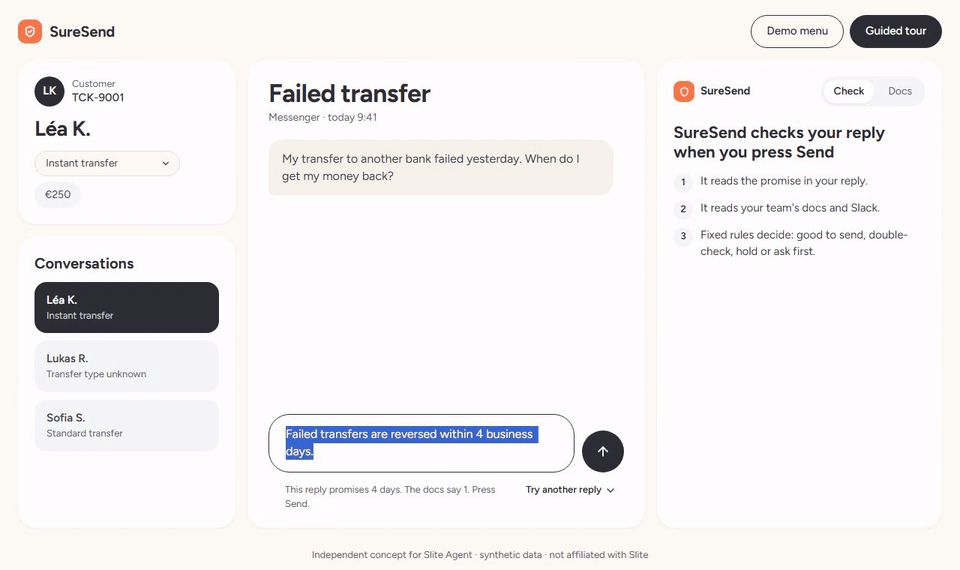
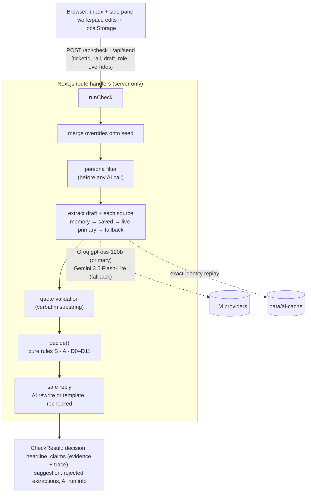

# SureSend

> Slite keeps the docs true. SureSend checks what people and agents say from those docs, at the moment they say it.

**An independent product concept for Slite Agent. Not affiliated with Slite. Synthetic data only.**

**Live demo:** https://suresend-demo.vercel.app · **Source:** https://github.com/1AbdullahButt/suresend



## The problem

Docs go stale, and between a policy change and the doc fix, an agent can still type the old answer into a customer
conversation. Slite asked 143 founders, operators and engineers about stale documentation: 76% had an AI tool surface a
stale doc and produce a wrong answer, and among them, 41% said that the wrong info has reached a customer
([source](https://slite.com/learn/dangers-of-stale-documentation)). Slite detects drift in docs and routes the fixes
through Triage, but the doc that's verified isn't always the one that governs: a newer, more specific exception can
override it, an informal Slack proposal can look authoritative, and an outdated macro can still be the first thing an
agent copies.

## What it does

A support agent writes a reply. When they press Send, SureSend checks it first:

1. It pulls the factual claims out of the draft (live AI).
2. It finds the matching claims in the team's messy docs and Slack (live AI, every quote validated as verbatim).
3. It weighs those sources with transparent, deterministic rules.
4. It returns **Good to send** (Allow), **Double-check** (Caution), **Hold** or **Ask first** (Escalate), plus a rechecked
   suggested reply and the full reasoning.

It checks two topics: when a failed transfer's money comes back, and whether the transfer fee is refunded. A reply that
makes both claims gets a verdict per claim, and the most severe one decides.

**The hypothesis.** Slite already has cited, permission-aware answers; drift detection with fixes reviewed in Triage; Ask
Insights; a Slack bot; MCP; and a Chrome extension. This concept tests something narrower, and it is presented as a
hypothesis (Slite may have something similar internally):

- check the **agent's own draft reply** at the moment of sending, not just answer a question;
- weigh conflicting sources with **explicit, inspectable rules**, where verification is one signal among several;
- measure **customer exposure**: unsafe sends intercepted, and the false-alarm rate.

## Try it in 60 seconds

No setup needed: the canonical path and the guided tour replay saved AI responses, so they work even when live AI is
unavailable or rate-limited.

- **Ayesha → Send → Hold.** Open Ayesha's ticket (instant rail) and press Send on the 4-day reply. It's held, because the
  instant-rail exception says 1 business day. Use the suggested reply and send it.
- **Fix the doc.** On the Hold, click "Fix the doc that caused this" to see the one line SureSend would add to the SOP,
  then approve or dismiss it.
- **Guided tour.** Press "Guided tour" in the header (on phones: Demo menu → Start guided tour) for the 6-step walkthrough.
- **The second topic.** Under the reply, "Try another reply" has presets. For Ayesha, "Right timeline, wrong fee" is held
  on the fee claim only, and the suggested reply keeps the right timeline.

<a name="use-it-from-claude"></a>

## Use it from Claude (MCP)

SureSend is also an MCP server, so any agent can check a reply against the docs before it sends it: Claude, a help-desk
bot, or an agent like Slite's.

**Connector URL:** `https://suresend-demo.vercel.app/api/mcp`. **No auth:** it only reads the public, synthetic demo
workspace, so don't send real customer data to it. In the app, the Demo menu's "Use it from Claude (MCP)" section has
this URL with a Copy button.

- **claude.ai:** add it as a custom connector (in Settings → Connectors at the time of writing; menus move). Step-by-step,
  with a demo prompt: [docs/MCP_DEMO.md](docs/MCP_DEMO.md).
- **Claude Code:** `claude mcp add --transport http suresend https://suresend-demo.vercel.app/api/mcp`
- **Locally over stdio** (Claude Code or Claude Desktop, from a clone):
  `claude mcp add suresend-local -- pnpm --dir /path/to/suresend exec tsx scripts/mcp-stdio.ts`

| Tool | What it does |
|---|---|
| `check_reply` | Checks a reply against the docs: the decision, why, the next step, a verdict per claim and a checked suggested reply. |
| `list_tickets` | Lists the 3 demo tickets. |
| `get_doc` | Returns one doc the support agent can see. |
| `propose_doc_fix` | For a Hold or Ask first, the doc to fix and a minimal fix to it. Applies nothing. |

Try these prompts:

1. "Reply to Ayesha's failed instant transfer. Check it with SureSend before you send."
2. "Usman doesn't know which payment rail his transfer used. Draft a reply about when his money comes back, and check it
   with SureSend first."
3. "Is 'Your refund will arrive within 4 business days' right for Hina's standard transfer? Show me the doc SureSend relied on."

How the MCP server works (inputs, limits, transport) is under [Architecture](#architecture).

## From held replies to doc fixes

A Hold or an Ask first is a signal that some doc taught the agent the wrong thing. SureSend finds that doc and proposes a
fix to it, and a person approves it, like fixes reviewed in Slite's Triage: nothing is applied without approval.

1. **Find the doc.** The held reply's value is matched against the claims in the visible docs. In the demo, "4 business
   days" comes from the SOP, which covers all rails but never mentions the instant-rail exception. If no general doc taught
   the value, or the doc already covers the exception, there's no proposal and nothing is shown.
2. **Draft a minimal fix.** The AI drafts one added sentence from the exception's own quote, and the rules validate it so
   nothing else in the doc can change (the full rules are under [Architecture](#architecture)). If the AI's draft fails,
   a template built from the exception's sentence is used instead.
3. **Recheck before offering it.** The demo's canonical replies are rechecked with the fix applied. If any decision would
   change, the fix isn't offered.
4. **A person approves it.** On the Hold or Ask first card, "Fix the doc that caused this" opens a Triage-style review in
   the Docs tab: the doc, why ("A reply this session copied 4 business days from this doc"), only the changed line before
   and after, and "Approve fix (simulated)" or "Dismiss". Approving saves the edit as an ordinary doc edit, verified
   (simulated). The Demo menu lists **Docs causing held replies** with a hold count per doc, simulated in your browser.

It covers timeline holds; a fee Hold gets no proposal. The canonical path replays saved responses (the AI's fix
included), so it never needs live AI. Agents can ask for the same
proposal over MCP with `propose_doc_fix`, which applies nothing.

## AI vs rules

| The AI does | The rules do |
|---|---|
| Pull claims out of the draft and each source: topic, value, unit, scope, effective date, status wording, supersession sentence, **verbatim quote** | Validate every quote, assign each claim a standing, check scope, settle conflicts, compare values, pick the decision |
| Word the safe reply from given facts | Recheck the safe reply; fall back to a template if it fails |

**The AI never decides the outcome.** The decision is a pure function, `decide(extractions, sources, ticket, now)` in
[`lib/engine/decide.ts`](lib/engine/decide.ts). Every rule writes a trace entry, shown in the SureSend card's Why and Trace views.
"The AI found nothing" is never treated as "safe": a deterministic policy-pattern detector catches timelines the AI missed,
an unreadable source caps the result at Caution, and a reply that leaves the customer's question open is a Double-check, because
staying silent isn't the same as being right. Sending says what happened ("Sent. Nothing in the docs contradicted it."), never
that the reply was correct.

Key rules (full table in [SPEC.md §6](SPEC.md)):

- **Verification is not authority.** It only adds or removes weakeners; it never breaks a tie.
- **Explicit supersession beats inferred specificity** (D5 before D6), and every D5 condition is written to the trace.
- **Recency never breaks a tie.** Two general policies that disagree escalate.
- **Proposals never govern.** A Slack proposal or a future-effective change can only downgrade an Allow to Caution.

## Adding a topic

The rules don't know which topics exist. A topic is one file in [`lib/topics`](lib/topics), and its values are compared by
a comparator chosen by value kind ([`lib/engine/values.ts`](lib/engine/values.ts)). `fee_refund` ("is the transfer fee
refunded when a transfer fails?", yes or no, scoped by rail like the timeline) was added in
[one commit](https://github.com/1AbdullahButt/suresend/commit/43f1bbf4970f649a4da6a1271e388e4bc88dc2a6) that changes no decision rule:

| File | What changed |
|---|---|
| `lib/topics/feeRefund.ts` | New: the taxonomy entry. Its value kind, wording, extraction examples, detector pattern, headline, reply template |
| `lib/topics/index.ts` | Two lines to register it (the import and the list) |
| `lib/engine/values.ts` | A boolean comparator, the first yes/no value kind |
| `lib/ai/schemas.ts` | The yes/no value's JSON shape, and the schema version bumped |
| `lib/ai/prompts.ts` | The prompt version bumped (the prompt text comes from the topic file) |

The rule files (`decide.ts`, `resolve.ts`, `standing.ts`, `applicability.ts`, `severity.ts`) are not in that commit.
[`lib/engine/topicAgnostic.test.ts`](lib/engine/topicAgnostic.test.ts) fails if a rule file names a topic or reads a value's
amount, unit or flag itself.

The groundwork came first. A [refactor](https://github.com/1AbdullahButt/suresend/commit/4a411e55963564e740c8703e1d745fa45b2633ad) moved the duration comparison into the registry unchanged and
made the rules ask the registries; every saved decision stayed the same. Then suggested replies and the UI learned to
handle several claims (the engine already decided per claim), amounts on other topics got a value (so they're outside
coverage, not missed), and values got their topic's wording.

QA then found that the refactor had generalised the "nothing found" net too coarsely: one claim on any topic switched it
off for the others, so a fee claim could let a missed 4-day promise through as Good to send.
[The fix](https://github.com/1AbdullahButt/suresend/commit/576a6b3b50c916eed89e781c9118963c0fd50c50) makes the net per topic, as the spec states it for one topic. That was a logic correction to how
the rules were generalised, in `decide.ts`, and nothing in it names a topic. With one topic it's the old rule exactly. A
second QA round found the same gap in one more place: a claim whose span was the whole sentence still vouched for the
other topic in that sentence. [That fix](https://github.com/1AbdullahButt/suresend/commit/d8a9d61da69be3080ec0c8725f3155d86230bda5) closes it, again in `decide.ts` and again naming no topic.

**Scope is one axis today: the payment rail.** A claim says which rail it applies to (`instant`, `standard` or `any`), a ticket
says which rail it's on, and [`applicability.ts`](lib/engine/applicability.ts) compares the two. A new topic reuses that axis. A topic
that varies by plan tier or country needs more than a topic file:

- a new field on a claim's `scope`, in the schema and the extraction prompt (both versions bumped), and on the ticket;
- `applicability.ts` comparing every axis, so a claim applies only when all of them match, and "unknown" works per axis;
- `decide.ts` and `resolve.ts` reading "the scope" where they read the rail today: D1 (ask first when the answer depends on what's
  unknown) and D6 (the one specific claim wins);
- the wording that names the rail (headlines, topic sentences, the Ask-first template) and the rail picker in the UI.

That's a change to the rules' input, unlike a new topic, and nothing here has been built for it.

So the next topic that fits the rail needs a file in `lib/topics` with its examples, two lines to register it, and the prompt and schema
versions bumped. Only a new kind of value (not a duration, an amount or a yes/no) also needs a comparator in `values.ts`
and its JSON shape in `schemas.ts`. Its tests, golden cases and saved responses come on top.

## Architecture



- **AI providers:** two live providers behind one adapter ([`lib/ai/client.ts`](lib/ai/client.ts)): Groq
  (`openai/gpt-oss-120b`, strict JSON-schema output) and Google Gemini (`gemini-3.5-flash-lite`, native JSON-schema
  response). Groq is primary and Gemini the fallback, which is tried once on a 429 or quota error before saved responses take
  over. On the current prompt both pass the gate with no rejected quotes, so the eval's tie-break goes to field accuracy and picks Gemini, though Groq scores higher on
  decisions (below). Groq stays primary by decision, not by the eval: availability and latency matter more for the live path, and
  the field-accuracy gap changed no decision. [evals/results.md](evals/results.md) shows both. An Anthropic adapter is kept, off by default. See [DECISIONS.md](DECISIONS.md) D-001, D-017, D-019, D-044.
- **Saved responses:** `data/ai-cache/` holds recorded model outputs keyed by the full cache identity (task, prompt version,
  schema version, provider, model, input text, plus source kind or the safe-reply inputs). A file is used only if its
  stored identity hashes to its name.
- **Send integrity:** `POST /api/send` reruns the full check on the exact submitted text. Hold and Escalate return 409
  (an intercept), Caution needs an acknowledgement, and AI unavailable returns 503. A result the client sends back is
  ignored; the docs the check runs against are the workspace the client submits (see Limitations).
- **Permissions (simulated):** the persona filter runs before extraction, so a hidden source never reaches the AI or a
  response. Personas are not authorization: anyone can switch, and a real deployment would take the role from the session.
- **Spend limit:** Groq runs on the paid Developer tier with a $5/month hard spend limit. Gemini is free tier with no
  billing. The app also caps live checks at 500 a day and MCP at 200 a day.
- **Rate limiting on the public demo:** a shared Upstash Redis limiter from the Vercel Marketplace (a per-IP cap per 10
  minutes and a daily cap overall, set by `RATE_LIMIT_PER_10MIN` and `GLOBAL_LIVE_CHECKS_PER_DAY`; defaults 20 and 500),
  then the providers' limits, then the saved-response fallback with a "Live AI paused" badge (D-034). Responses
  from `/api/check` and `/api/send` carry `x-suresend-limiter`, which reads `upstash` after a live check went through the
  shared limiter. Without the Upstash vars the code falls back to an in-memory per-instance limiter. Input caps
  (4,000 chars per doc, 1,000 per draft, 6 sources) and free cache hits apply either way. The canonical path and the guided
  tour, including both ways of typing step 6's doc edit and the step-5 doc fix, replay saved responses, so they never spend live AI.
- **MCP server** (`/api/mcp`, Streamable HTTP, stateless):
  - `check_reply` takes `{ reply, ticket_id?, rail? }` and returns the decision (Good to send, Double-check, Hold, Ask
    first, or Couldn't check when the reply can't be read), headline, a one-line reason, the next step, a checked suggested
    reply, the governing quote and its doc, each claim with its own verdict, and the rules that mattered. It runs the same
    validation, caps, persona filter and engine as the web app, and covers the same two topics: when a failed transfer's
    money comes back, and whether the transfer fee is refunded. Other values come back Double-check.
  - `list_tickets` returns each demo ticket's customer, payment rail and message. `get_doc` returns one visible doc's
    title, verification signals and text; the restricted DOC-105 is never returned. `propose_doc_fix` takes the same inputs
    as `check_reply` and returns the reason and only the changed lines, before and after.
  - The tool descriptions tell the agent to call `check_reply` before sending any reply that states a timeline, and to
    send the suggested reply or ask a human on Hold or Ask first. Everything is read-only: nothing over MCP edits a doc.
  - Live AI over MCP has its own budget on the shared limiter (`MCP_RATE_LIMIT_PER_10MIN`, `MCP_LIVE_CHECKS_PER_DAY`;
    defaults 10 and 200), asked once per check. The endpoint takes one JSON-RPC message per request (no batches) and
    answers GET with 405, since it's stateless. The demo's canonical replies replay saved responses; new wording uses live AI.
- **Doc-fix validation:** the added sentence goes right after the claim sentence, which must be quoted exactly and appear
  once in the doc, so nothing else can change. It must state the exception's value exactly ("1 business day") and name
  that rail and no other. It may contain no other digits, no other detected timeline (including number words, months and
  "immediately"), and no negation, promise or fee wording. A rewrite counts only if it keeps the claim sentence word for word.
- **Hardening:** security headers (`frame-ancestors 'none'`, `nosniff`, referrer and permissions policies), generic 500
  bodies with the detail logged server-side only, zod on every request body, and a read-only CI token with SHA-pinned actions.

## Tests and eval

| | What | Result |
|---|---|---|
| `pnpm test` | Locked acceptance tests T1–T8 (engine on hand-written fixtures), cache-identity test, unit tests (incl. saved-response replay for the tour, the doc fix and the presets; Fix the doc; the fee topic; the guard that the rules name no topic; vague replies and rule D0e; that a suggestion's check matches its Send; the copy rules; the quota guard; held-out integrity; and the MCP tools, also over an in-memory MCP client, and the `/api/mcp` route) | 350 passed |
| `snapshot-results.ts` | Every saved path's decision and reason code, before and after the Phase 11 rule and prompt: golden, tour, doc fix | 66 of 68 identical. The other 2 are the no-claim reply (both personas), now a Double-check by rule D0e |
| `pnpm lint` | ESLint, `next/core-web-vitals` and `next/typescript`, no warnings allowed | clean |
| `pnpm mcp:e2e <url>` | The MCP client SDK against `/api/mcp` over HTTP: tools, tickets, docs (DOC-105 refused), Hold / Ask first / Good to send, a two-claim reply and a doc-fix proposal, all on saved responses | passed (local and live) |
| `pnpm exec playwright test` | One e2e in saved mode: wrong draft → Send → held → Use this reply → Send → sent → Demo menu shows 1 stopped | passed |
| `pnpm eval` | 25 golden cases (3 canonical tickets, Appendix B variants B1–B7, a 1-day Allow, a no-claim draft, 7 fee cases, 6 vague replies) × 3 runs × 2 providers | see below |
| `pnpm eval --heldout` | 16 clean held-out cases, and 6 exposed ones reported apart, × 3 runs × 2 providers | see below |
| `scripts/ui-audit.ts` | axe-core + screenshots, 10 states × 1440/1024/390 | 0 serious/critical, no horizontal scroll |

**Regression on the 25-case demo set.** The prompts were tuned on these cases, so this shows the demo path is stable, not
that it generalises. From [evals/results.md](evals/results.md) (prompt `2026-11-02.5`):

| Provider · model | Decision accuracy | Quote validity | Extraction field accuracy | Gate (canonical + B1, B2, B3, B7, 3/3 runs) |
|---|---|---|---|---|
| Groq · `openai/gpt-oss-120b` | 98.7% (74/75) | 100% (107/107) | 98.9% (178/180) | PASS |
| Gemini (fallback) · `gemini-3.5-flash-lite` (before QA's fixes) | 86.7% (65/75) | 100% (107/107) | 100% (180/180) | PASS |

Every miss on both providers is on the six vague replies, and none reached Good to send. These score against the expected reason. Groq read
one fee wording as "not refunded" once, which gives a Hold. Gemini did that on 4 runs, and on 6 it found no claim, so rule D0e's Double-check caught them.

Groq's field accuracy is below 100% because it read DOC-101 as "in force" where the hand-written fixtures say "unstated". An earlier session on
this prompt, before QA's fixes, scored 75/75 and 170/180, also misreading DOC-104 and the Slack proposal. The prompt for reading docs didn't change in
this phase, so that's the model varying. No decision changed.

**Gemini's rows ran before QA's rule fixes.** The rerun hit its 500-a-day free limit on 2 Nov, and it follows in its own commit. Those fixes change what happens
with an unread doc, a reply that only resembles the holding reply, and an AI rewrite that drops an answer. The reports show the run times.

A first Gemini run missed the Slack proposal and rejected two quotes until the prompt said proposals are claims and quotes
exclude markdown labels (the fix was in the prompt, never the rules or tests).

**Held-out set (16 clean cases).** A case whose wording reached the prompts or golden set doesn't count, even after that
wording is removed. From [evals/heldout.md](evals/heldout.md), live, 3 runs each, with the prompts frozen first:

| Provider · model | All clean cases | Fee cases only (H12, H17–H19) | Vague replies only (H20–H22) | Quote validity |
|---|---|---|---|---|
| Groq · `openai/gpt-oss-120b` | 97.9% (47/48) | 91.7% (11/12) | 100% (9/9) | 100% (97/97) |
| Groq, earlier session on this prompt (before QA's fixes) | 95.8% (46/48) | 83.3% (10/12) | 100% (9/9) | 100% (98/98) |
| Gemini (fallback) · `gemini-3.5-flash-lite` (before QA's fixes) | 91.7% (44/48) | 83.3% (10/12) | 77.8% (7/9) | 100% (91/91) |
| Earlier prompt (`2026-11-02.4`), 13 cases: Groq, two sessions | 92.3% (36/39), then 100% (39/39) | 75% (9/12), then 100% (12/12) | no such cases | 100% |
| Earlier prompt (`2026-11-02.4`), 13 cases: Gemini | 100% (39/39) | 100% (12/12) | no such cases | 100% (81/81) |

- **The vague replies are the evidence for this phase's prompt change.** H20–H22 were committed before any prompt work on valueless
  claims, and the same test checks them for shared phrases. They're three cases, so it's a first check. They score against the reason, so a
  reply the AI misses and rule D0e catches still counts as a miss here: Gemini's two are that (H22).
- **Three expected results changed with the rule, not the case:** H10, H12 and H13 leave the customer's question open, so they're
  now Double-check where they were Good to send (D-045).

- **The fee cases are the real evidence for the new topic.** H12 was written before any fee prompt text existed. H17–H19 were
  written after the final freeze: two claims after a doc edit, a hedge, and an amount outside coverage.
  [A test](lib/ai/heldoutIntegrity.test.ts) fails if any of the four shares a three-word phrase with the prompts, schema,
  golden set or presets, or if the system prompts or schemas change after the freeze.
- **The timeline cases** (H1–H4, H6–H10) were written after an earlier freeze: reworded drafts ("working days", a number word, a
  hedge), the unknown-rail ticket, a reworded SOP on both rails, a reworded Slack proposal, an injection inside the draft and
  a no-claim reply. They were in the repo while the fee prompts were written and already passed on earlier prompts, so they
  show nothing broke, not that the new topic works. H1 reuses phrases that older prompt already had.

**Hedges aren't stable.** H18 is a hedged "not refunded" ("As far as I can tell, you won't recover the service charge…"). On one
frozen prompt, Groq returned Hold on all 3 runs of one session and Double-check on all 3 of the next, and nothing was tuned between them
([first session](https://github.com/1AbdullahButt/suresend/blob/1db5346/evals/heldout.md)). On this prompt it's 1 of 3, then 2 of 3. H14, its
exposed twin, has gone 3/3, 2/3, 3/3 and 3/3. A miss here errs strict: the reply is stopped, not let through.

**Marking vague fee wording as valueless has a cost.** H11 says "the transfer charge stays with us", a plain "not refunded". On the earlier
prompt Groq held it on all 3 runs of its last session. On this one it read the charge as vague on 2 of 6 runs (1 of 3 right, then 3 of 3), so those get a Double-check, not a
Hold. It isn't let through, but it's weaker on a reply that's wrong. H11 is exposed, so it's not in the clean score, and it's why this is called out here.

**Exposed cases (6): regression only, not held-out.** H5, H11, H13, H14, H15 and H16. Their wording reached the prompts or the
golden set, or shares a phrase with drafts written after them. Where it could be removed, it was, and they still don't count
(D-041). They're shown so nothing is hidden, not as evidence. H14 tests the same behaviour as H18 and was the one that leaked.

| Provider · model | Decision accuracy | Quote validity |
|---|---|---|
| Groq · `openai/gpt-oss-120b` | 88.9% (16/18) | 100% (41/41) |
| Gemini (fallback) · `gemini-3.5-flash-lite` (before QA's fixes) | 94.4% (17/18) | 100% (39/39) |

Groq's two misses are both H13, whose "It is returned along with your money" it read as a timeline with no value. That's still a Double-check, for a
different reason.

Read it for what it is: 16 cases around one scenario, a first check on generalisation, not proof. Three expectations rest on
conventions the project adopted: "4 days" without "business" means calendar days (H5, now exposed); a signalled change is compared on the
amount only, so a proposed "1 day" doesn't contradict "1 business day" (H3); and the exception supersedes the SOP by naming
its title, even after the SOP is reworded (H7).

## Run it

```bash
pnpm install
cp .env.example .env.local   # add GROQ_API_KEY (and GEMINI_API_KEY for the fallback), or set AI_MODE=saved
pnpm dev
```

| Command | What it does |
|---|---|
| `pnpm test` | Acceptance + unit tests (fixtures, no network) |
| `pnpm lint` | ESLint, no warnings allowed |
| `pnpm e2e` | Playwright demo flow in saved mode |
| `pnpm eval` | Live eval on both providers → `evals/results.md` |
| `pnpm eval --saved` | Replays saved responses only (no key needed) |
| `pnpm eval --heldout` | Live held-out cases on both providers → `evals/heldout.md` (report only) |
| | `pnpm eval` and `pnpm record` check the provider's quota first and stop on the first daily limit or an outage (exit code 3) without changing that provider's report. A provider error gives no answer, so it's retried and never scored. Re-running an eval continues it: finished cases keep their results, and a provider that already finished isn't run again (`--fresh` forces it) |
| `pnpm record` | Re-records all of `data/ai-cache/` with the primary provider: golden cases, presets, the tour's doc edit, Fix the doc. Built aside; replaces the folder only if it finishes with nothing unexpected |
| `pnpm record --resume` | Continues a recording that stopped on a quota limit |
| `pnpm record --tour-edits` | Adds only what the tour's step-6 doc edit needs; never clears existing saved responses |
| `pnpm mcp:e2e [url]` | Checks an MCP endpoint end to end (default `http://127.0.0.1:3100/api/mcp`) |
| `pnpm record --fix-edits` | Adds only what Fix the doc needs on the canonical path; never clears existing saved responses |
| `pnpm record --presets` | Adds only the composer's "Try another reply" presets; never clears existing saved responses |
| `pnpm tsx scripts/snapshot-results.ts <out.json> [--compare <before.json>]` | Every saved path's decision and reason code (golden, tour, Fix the doc) on saved responses only, compared with an earlier run |

## How it was built

Built by Claude Code with a gated agent loop (builder, tester, QA and designer subagents; a hook that locks the tests and
the spec; a Stop hook that refuses to end a phase without evidence). The log with real test output for every phase is in
[PROGRESS.md](PROGRESS.md); every judgment call is in [DECISIONS.md](DECISIONS.md).

## Limitations

- **More Double-checks on correct but vague replies.** A reply that gives no value, or leaves the customer's question open, is a
  Double-check even when nothing in it is wrong. "I've passed this to our payments team and will update you" is honest and still
  gets one; so does a correct fee-only reply to someone asking when their money comes back. Only SureSend's own holding wording ("I'm
  confirming the exact reversal timeline…") goes through. Every seed ticket asks about the timeline, so in this demo that covers every
  reply that doesn't state it. That's the price of never calling a silent reply safe (D-045).
- What a customer is asking is keyword matching, per topic (`asks` in each topic file). A question in unusual words doesn't trigger
  the check. Over MCP with no `ticket_id` there's no question to compare with, so a vague reply the AI also misses reads as Good to send.
- Two topics (`reversal_window`, `fee_refund`) plus `other`: any other factual claim, such as a fee amount or a limit, is
  "outside coverage" (Caution). The rules are topic-agnostic; the next topic needs a file in `lib/topics` with its
  examples, and a comparator only for a new kind of value (see Adding a topic).
- The "nothing found" detector works per topic: it flags a topic's pattern when no claim on that topic was extracted, unless
  an out-of-topic claim already covers those words. If a reply makes two claims on the same topic and the AI catches only
  one, the other isn't flagged.
- The detector only knows common wording. A fee statement in unusual words, such as "we also repay the service charge", gets
  past it, so if the AI misses that too and the reply answers what the customer asked, it reads as Good to send. Its words aren't added, since those come from the
  held-out cases.
- A fee statement with a timing word in it ("refunded within the same transfer") gets a Double-check even when it's right,
  because a claim on one topic never vouches for another. That's the safe direction.
- A currency amount is flagged only when no claim on a checked topic was found. In "The transfer fee is refunded, all PKR 25 of
  it", with only the fee claim extracted, the amount isn't checked.
- The Gemini fallback can't answer within the 9-second timeout while Gemini is overloaded, as on 2 Nov (503 errors, and 20 to 30
  seconds per call). A check that needs the fallback then gets saved responses, or can't be checked until Gemini recovers.
- Fix the doc covers timeline holds. A fee Hold gets no doc fix proposal.
- Send integrity holds against the workspace the client submits. In the demo the docs live in the browser, so a client
  could submit edited docs; in a real deployment the docs would come from Slite, not the browser.
- Personas are simulated: anyone can switch. DOC-105 is synthetic. Never use this design with real restricted data.
- The MCP server has no auth because it only reads this public, synthetic workspace. A real one would sit behind the
  workspace's own sign-in and check the caller's permissions.
- No real Slite or Intercom integration; all data is synthetic.
- Live AI stops at the app's daily caps, Groq's $5/month spend limit or Gemini's free-tier quota. Past those, checks fall
  back to saved responses with a visible badge, and text with no saved response can't be checked until the limit clears.
- Saved responses cover the seeded docs, the Appendix B variants, the canonical drafts, the tour's step-6 edit and the canonical doc fix;
  arbitrary new text needs live AI.
- The eval is small and built around one scenario; the held-out set (16 clean cases) is a first check on generalisation, not proof.
- A hedge the prompt doesn't list can read as definite: "As far as I can tell" came back Hold, not Double-check, on 6 of 12 Groq runs (H18).

## What not to claim

- That Slite lacks this internally.
- That it connects to real Slite or Intercom data.
- That intercepted sends equal prevented customer harm.
- That the AI decides policy. The rules do, and they escalate when unsure.
- That it's production-ready. It still needs real permissions, integrations, security and legal review.

---

Name: SureSend was called AnswerGuard in SPEC v2.2 and the brief. The old https://answerguard.vercel.app redirects to the
live demo.
