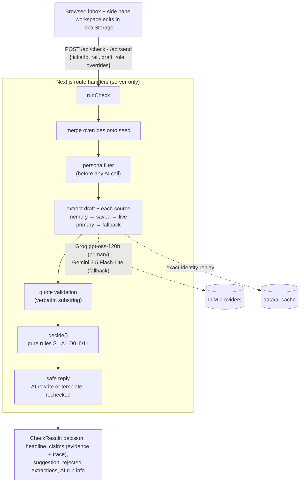

# Architecture

[Back to the README](../README.md)

How SureSend works, in full. Doc fixes and cited evidence aren't new ideas here: Slite Agent already does both, and SureSend
includes them so the flow is complete.

## Background

> Slite keeps the docs true. SureSend checks what people and agents say from those docs, at the moment they say it.

Docs go stale, and between a policy change and the doc fix, an agent can still type the old answer into a customer
conversation. Slite asked 143 founders, operators and engineers about stale documentation: 76% had an AI tool surface a
stale doc and produce a wrong answer, and among them, 41% said that the wrong info has reached a customer
([source](https://slite.com/learn/dangers-of-stale-documentation)). Slite detects drift in docs and routes the fixes
through Triage, but the doc that's verified isn't always the one that governs: a newer, more specific exception can
override it, an informal Slack proposal can look authoritative, and an outdated macro can still be the first thing an
agent copies.

## What it does

A support agent writes a reply. When they press Send, SureSend checks it first:

1. It pulls the factual claims out of the draft (live AI).
2. It finds the matching claims in the team's messy docs and Slack (live AI, every quote validated as verbatim).
3. It weighs those sources with transparent, deterministic rules: on the same ticket at the same time, the same AI findings and the same docs always produce the same decision.
4. It returns **Good to send** (Allow), **Double-check** (Caution), **Hold** or **Ask first** (Escalate), plus a rechecked
   suggested reply and the full reasoning.

It checks two topics: when a failed transfer's money comes back, and whether the transfer fee is refunded. A reply that
makes both claims gets a verdict per claim, and the most severe one decides.

**The hypothesis.** Slite already has cited, permission-aware answers; drift detection with fixes reviewed in Triage; Ask
Insights; a Slack bot; MCP; and a Chrome extension. This concept tests something narrower, and it is presented as a
hypothesis (Slite may have something similar internally):

- check the **agent's own draft reply** at the moment of sending, not just answer a question;
- weigh conflicting sources with **explicit, inspectable rules**, where verification is one signal among several;
- measure **customer exposure**: unsafe sends intercepted, and the false-alarm rate.

## More to try in the demo

No setup needed: the canonical path and the guided tour replay saved AI responses, so they work even when live AI is
unavailable or rate-limited.

- **Léa → Send → Hold.** Open Léa's ticket (instant transfer) and press Send on the 4-day reply. It's held, because the
  instant-transfer exception says 1 business day. Use the suggested reply and send it.
- **Fix the doc.** On the Hold, click "Fix the doc that caused this" to see the one line SureSend would add to the SOP,
  then approve or dismiss it.
- **Guided tour.** Press "Guided tour" in the header (on phones: Demo menu → Start guided tour) for the 6-step walkthrough.
- **The second topic.** Under the reply, "Try another reply" has presets. For Léa, "Right timeline, wrong fee" is held
  on the fee claim only, and the suggested reply keeps the right timeline.

## From held replies to doc fixes

A Hold or an Ask first is a signal that some doc taught the agent the wrong thing. SureSend finds that doc and proposes a
fix to it, and a person approves it, like fixes reviewed in Slite's Triage: nothing is applied without approval.

1. **Find the doc.** The held reply's value is matched against the claims in the visible docs. In the demo, "4 business
   days" comes from the SOP, which covers all transfers but never mentions the instant-transfer exception. If no general doc taught
   the value, or the doc already covers the exception, there's no proposal and nothing is shown.
2. **Draft a minimal fix.** The AI drafts one added sentence from the exception's own quote, and the rules validate it so
   nothing else in the doc can change (the full rules are under [The system](#the-system)). If the AI's draft fails,
   a template built from the exception's sentence is used instead.
3. **Recheck before offering it.** The demo's canonical replies are rechecked with the fix applied. If any decision would
   change, the fix isn't offered.
4. **A person approves it.** On the Hold or Ask first card, "Fix the doc that caused this" opens a Triage-style review in
   the Docs tab: the doc, why ("A reply this session copied 4 business days from this doc"), only the changed line before
   and after, and "Approve fix (simulated)" or "Dismiss". Approving saves the edit as an ordinary doc edit, verified
   (simulated). The Demo menu lists **Docs causing held replies** with a hold count per doc, simulated in your browser.

It covers timeline holds; a fee Hold gets no proposal. The canonical path replays saved responses (the AI's fix
included), so it never needs live AI. Agents can ask for the same
proposal over MCP with `propose_doc_fix`, which applies nothing.

## AI vs rules

| The AI does | The rules do |
|---|---|
| Pull claims out of the draft and each source: topic, value, unit, scope, effective date, status wording, supersession sentence, **verbatim quote** | Validate every quote, assign each claim a standing, check scope, settle conflicts, compare values, pick the decision |
| Word the safe reply from given facts | Recheck the safe reply; fall back to a template if it fails |

**The AI never decides the outcome.** The decision is a pure function, `decide(extractions, sources, ticket, now)` in
[`lib/engine/decide.ts`](../lib/engine/decide.ts). Every rule writes a trace entry, shown in the SureSend card's Why and Trace views.
On the same ticket at the same time, the same AI findings and the same docs always produce the same decision. That isn't the same as "same reply, same verdict": the AI can read the
same words differently from one run to the next, even at temperature 0, and a different reading can get a different verdict (see [Limitations](limitations.md)).
"The AI found nothing" is never treated as "safe": a deterministic policy-pattern detector catches timelines the AI missed,
an unreadable source caps the result at Caution, and a reply that leaves the customer's question open is a Double-check, because
staying silent isn't the same as being right. Sending says what happened ("Sent. Nothing in the docs contradicted it."), never
that the reply was correct.

Key rules (full table in [SPEC.md §6](../SPEC.md)):

- **Verification is not authority.** It only adds or removes weakeners; it never breaks a tie.
- **Explicit supersession beats inferred specificity** (D5 before D6), and every D5 condition is written to the trace.
- **Recency never breaks a tie.** Two general policies that disagree escalate.
- **Proposals never govern.** A Slack proposal or a future-effective change can only downgrade an Allow to Caution.

## The system

- **AI providers:** two live providers behind one adapter ([`lib/ai/client.ts`](../lib/ai/client.ts)): Groq
  (`openai/gpt-oss-120b`, strict JSON-schema output) and Google Gemini (`gemini-3.5-flash-lite`, native JSON-schema
  response). Groq is primary and Gemini the fallback, which is tried once on a 429 or quota error before saved responses take
  over. On the previous prompt (`2026-11-02.6`) both passed the gate with no rejected quotes, so the eval's tie-break went to field accuracy and picked Gemini, though Groq scored higher on verdict and reason together, and Gemini on
  the verdict alone ([evals](evals.md)). Gemini hasn't run on the current prompt yet. Groq stays primary by decision, not by the eval: availability and latency matter more for the live path, and
  the field-accuracy gap changed no decision. [evals/results.md](../evals/results.md) shows the pick and the override whenever both have run on the current prompt. An Anthropic adapter is kept, off by default. See [DECISIONS.md](../DECISIONS.md) D-001, D-017, D-019, D-044.
- **Saved responses:** `data/ai-cache/` holds recorded model outputs keyed by the full cache identity (task, prompt version,
  schema version, provider, model, input text, plus source kind or the safe-reply inputs). A file is used only if its
  stored identity hashes to its name.
- **Send integrity:** `POST /api/send` reruns the full check on the exact submitted text. Hold and Escalate return 409
  (an intercept), Caution needs an acknowledgement, and AI unavailable returns 503. A result the client sends back is
  ignored; the docs the check runs against are the workspace the client submits (see [Limitations](limitations.md)).
- **Permissions (simulated):** the persona filter runs before extraction, so a hidden source never reaches the AI or a
  response. Personas are not authorization: anyone can switch, and a real deployment would take the role from the session.
- **Spend limit:** Groq runs on the paid Developer tier with a $5/month hard spend limit. Gemini is free tier with no
  billing. The app also caps live checks at 500 a day and MCP at 200 a day.
- **Rate limiting on the public demo:** a shared Upstash Redis limiter from the Vercel Marketplace (a per-IP cap per 10
  minutes and a daily cap overall, set by `RATE_LIMIT_PER_10MIN` and `GLOBAL_LIVE_CHECKS_PER_DAY`; defaults 20 and 500),
  then the providers' limits, then the saved-response fallback with a "Live AI paused" badge (D-034). Responses
  from `/api/check` and `/api/send` carry `x-suresend-limiter`, which reads `upstash` after a live check went through the
  shared limiter. Without the Upstash vars the code falls back to an in-memory per-instance limiter. Input caps
  (4,000 chars per doc, 1,000 per draft, 6 sources) and free cache hits apply either way. The canonical path and the guided
  tour, including both ways of typing step 6's doc edit and the step-5 doc fix, replay saved responses, so they never spend live AI.
- **MCP server** (`/api/mcp`, Streamable HTTP, stateless):
  - `check_reply` takes `{ reply, ticket_id?, rail? }` and returns the decision (Good to send, Double-check, Hold, Ask
    first, or Couldn't check when the reply can't be read), headline, a one-line reason, the next step, a checked suggested
    reply, the governing quote and its doc, each claim with its own verdict, and the rules that mattered. It runs the same
    validation, caps, persona filter and engine as the web app, and covers the same two topics: when a failed transfer's
    money comes back, and whether the transfer fee is refunded. Other values come back Double-check.
  - `list_tickets` returns each demo ticket's customer, transfer type and message. `get_doc` returns one visible doc's
    title, verification signals and text; the restricted DOC-105 is never returned. `propose_doc_fix` takes the same inputs
    as `check_reply` and returns the reason and only the changed lines, before and after.
  - The tool descriptions tell the agent to call `check_reply` before sending any reply that states a timeline, and to
    send the suggested reply or ask a human on Hold or Ask first. Everything is read-only: nothing over MCP edits a doc.
  - Live AI over MCP has its own budget on the shared limiter (`MCP_RATE_LIMIT_PER_10MIN`, `MCP_LIVE_CHECKS_PER_DAY`;
    defaults 10 and 200), asked once per check. The endpoint takes one JSON-RPC message per request (no batches) and
    answers GET with 405, since it's stateless. The demo's canonical replies replay saved responses; new wording uses live AI.
- **Doc-fix validation:** the added sentence goes right after the claim sentence, which must be quoted exactly and appear
  once in the doc, so nothing else can change. It must state the exception's value exactly ("1 business day") and name
  that transfer type and no other. It may contain no other digits, no other detected timeline (including number words, months and
  "immediately"), and no negation, promise or fee wording. A rewrite counts only if it keeps the claim sentence word for word.
- **Hardening:** security headers (`frame-ancestors 'none'`, `nosniff`, referrer and permissions policies), generic 500
  bodies with the detail logged server-side only, zod on every request body, and a read-only CI token with SHA-pinned actions.

## The name

Name: SureSend was called AnswerGuard in SPEC v2.2 and the brief. The old https://answerguard.vercel.app redirects to the
live demo.
