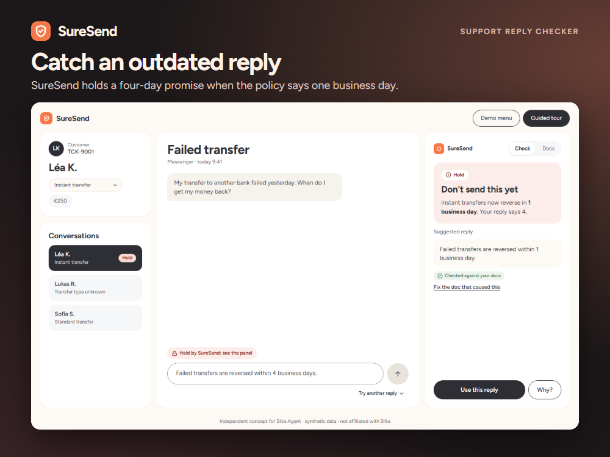
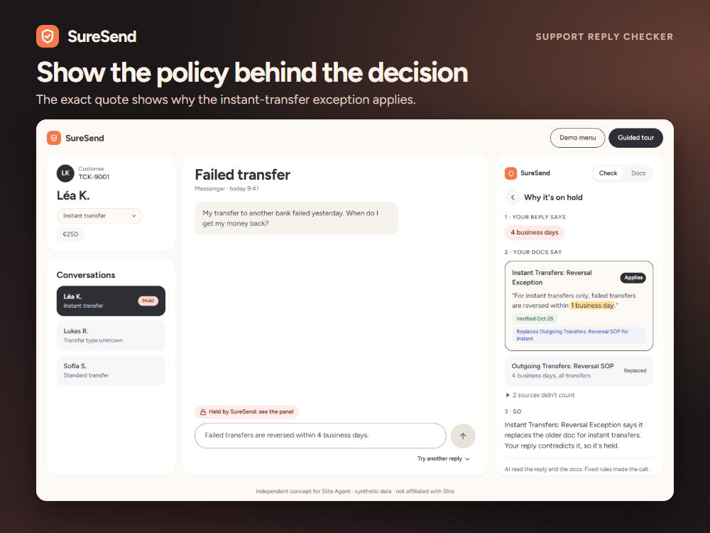
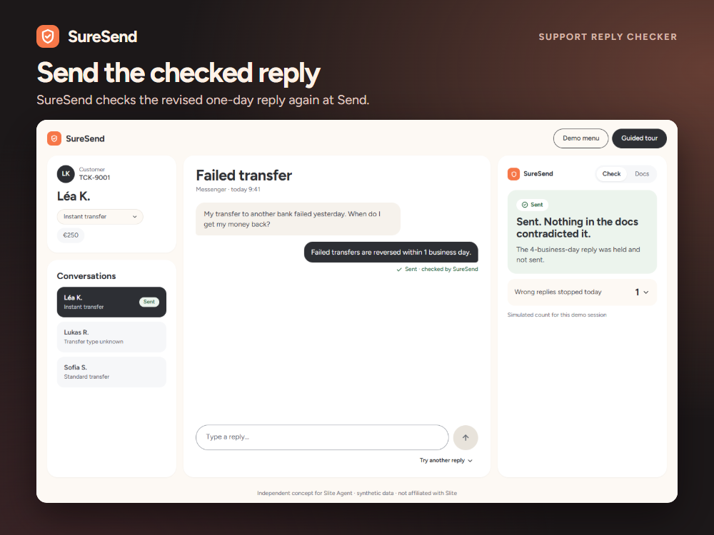
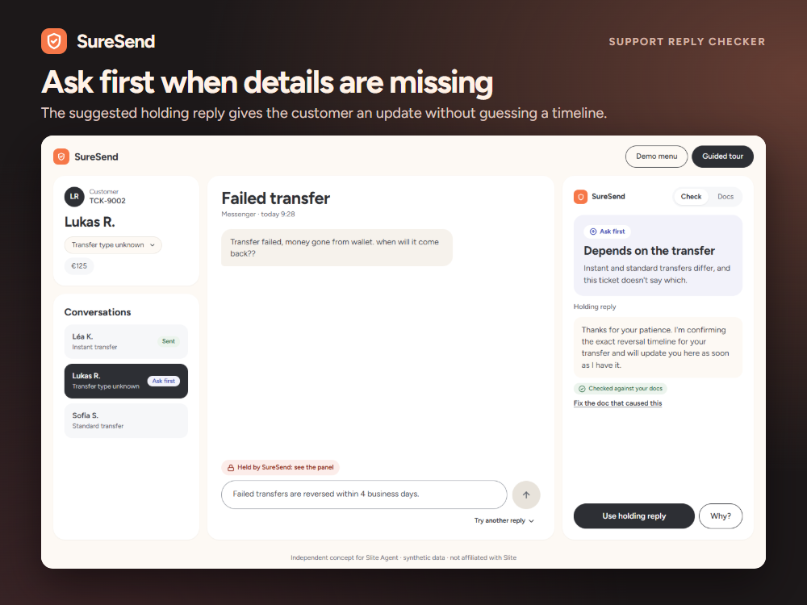
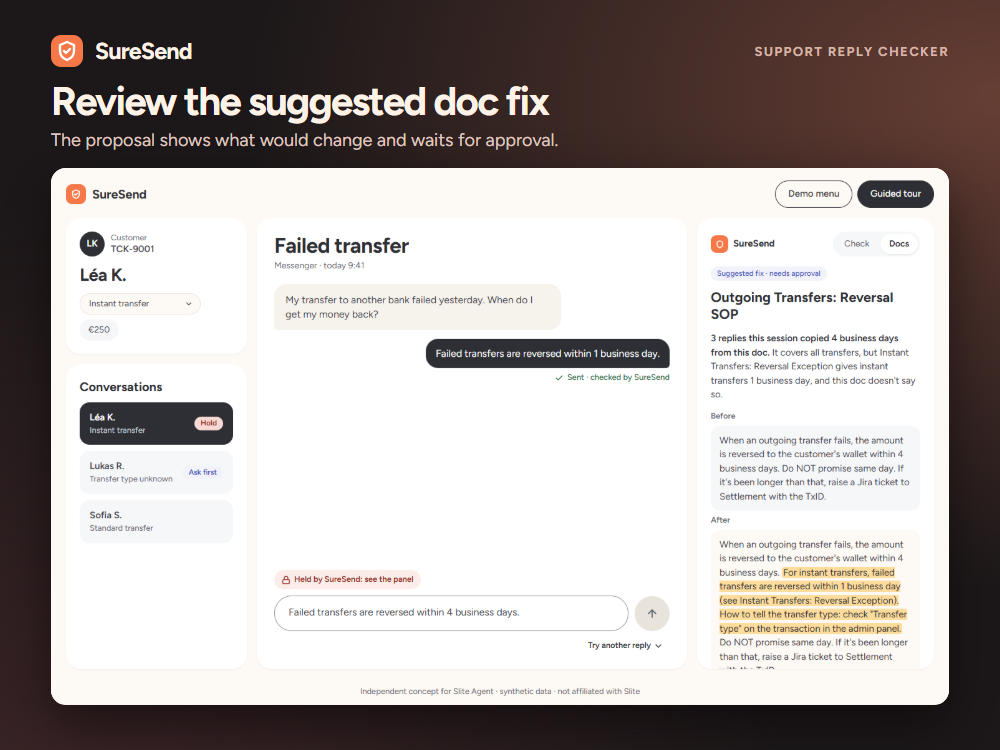
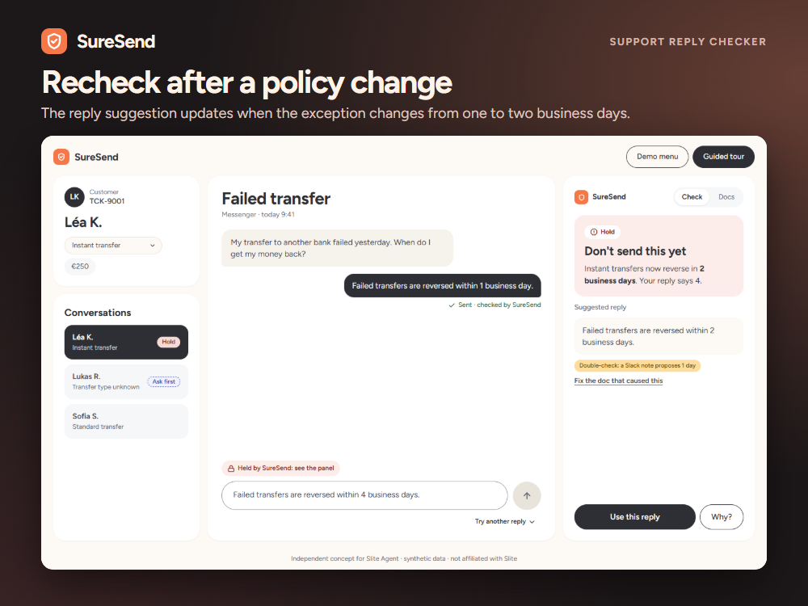
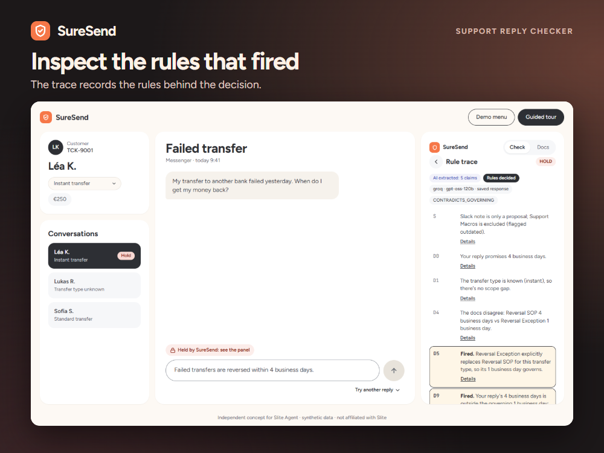

# SureSend screenshots

[Back to the README](../README.md)

Seven screens from the live demo, in the order a reply moves through it. All data is synthetic. The same path is in the
[52-second walkthrough](https://github.com/1AbdullahButt/suresend/releases/tag/demo-walkthrough).

## 1. Catch an outdated reply

SureSend holds a four-day promise when the policy says one business day.

## 2. Show the policy behind the decision

The exact quote shows why the instant-transfer exception applies, and which part of the general policy it replaces.

## 3. Send the checked reply

SureSend checks the revised one-day reply again at Send.

## 4. Ask first when details are missing

When the ticket doesn't say which transfer type it is, the suggested holding reply gives the customer an update without guessing a timeline.

## 5. Review the suggested doc fix

The proposal shows what would change in the doc and waits for approval.

## 6. Recheck after a policy change

When the exception changes from one to two business days, the suggested reply updates to match.

## 7. Inspect the rules that fired

The trace records which rules decided, and which quote governs.

## More

- [Product case study](../portfolio-media/upwork/sample-documents/SureSend-Product-Case-Study.pdf) (PDF)
- [Technical walkthrough](../portfolio-media/upwork/sample-documents/SureSend-Technical-Walkthrough.pdf) (PDF)
- [Live demo](https://suresend-demo.vercel.app)
